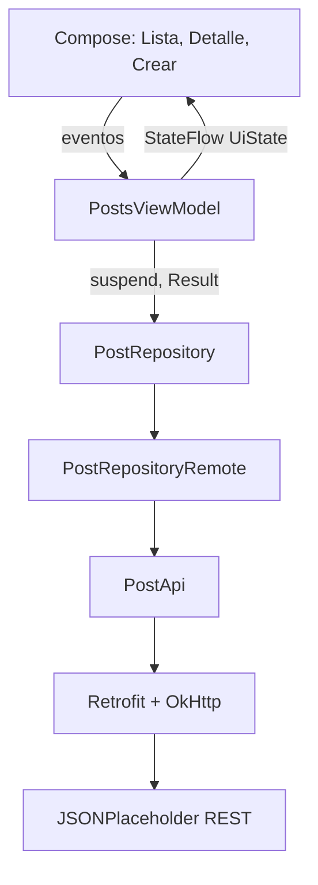

# MuroCampus

Aplicación Android en Kotlin y Jetpack Compose para consultar, filtrar y crear publicaciones con JSONPlaceholder. La app usa Retrofit y OkHttp para la red, kotlinx.serialization para JSON y MVVM con Repository para mantener separadas la interfaz y las llamadas HTTP.

## Estructura

```text
com.ronda.murocampus/
├── MainActivity.kt
├── model/
│   └── Modelos.kt
├── data/
│   ├── PostRepository.kt
│   └── remote/
│       ├── PostApi.kt
│       └── RetrofitClient.kt
├── viewmodel/
│   ├── PostsViewModel.kt
│   └── PostsViewModelFactory.kt
└── ui/
    ├── Componentes.kt
    ├── PantallaLista.kt
    ├── PantallaDetalle.kt
    ├── PantallaCrear.kt
    └── theme/
```

## Arquitectura MVVM



La pantalla observa el estado y envía eventos al ViewModel. El ViewModel solo conoce `PostRepository`; el Repository captura fallos de red y los devuelve con `Result`. Las cancelaciones de corrutinas se vuelven a lanzar.

## Capturas

La guía requiere cinco capturas reales de la app: lista, detalle, filtro, formulario de creación y error sin conexión. No hay un emulador iniciado en este entorno, así que estas capturas quedan pendientes de tomar y guardar en `screenshots/` antes de entregar la sustentación.

| Pantalla | Archivo esperado |
| --- | --- |
| Lista | `screenshots/lista.png` |
| Detalle y comentarios | `screenshots/detalle.png` |
| Filtro de usuario | `screenshots/filtro.png` |
| Crear publicación | `screenshots/crear.png` |
| Error de conexión | `screenshots/error-conexion.png` |

## Para pensar

1. **¿Qué diferencia hay entre GET y POST? ¿Por qué crear lleva `@Body` y `porUsuario` lleva `@Query`?** GET consulta un recurso. POST envía datos para crear uno. `@Body` serializa la publicación como JSON en el cuerpo de la solicitud; `@Query` añade `userId` a la URL para filtrar la lista.
2. **¿Por qué la ruta es `posts` y no `/posts`?** Retrofit resuelve rutas relativas contra la URL base. La barra inicial puede descartar el segmento de ruta de esa base.
3. **¿Por qué el Repository devuelve `Result`?** Encapsula el éxito o el fallo de red en un valor. Así el ViewModel decide qué estado presentar sin dejar que una excepción de Retrofit cierre la pantalla.
4. **¿Qué pasa si se olvida `INTERNET` o `ignoreUnknownKeys`?** Sin el permiso, Android bloquea el acceso a la red. Sin `ignoreUnknownKeys`, un campo nuevo que el modelo no conoce puede provocar un error de serialización.
5. **¿Por qué la lista usa `when` sobre `UiState`?** El estado sellado representa explícitamente Cargando, Éxito o Error y obliga a presentar cada caso de forma clara.
6. **¿Cómo cambiaría la app con un servicio real que guarda los POST?** Se podría actualizar la lista con el objeto confirmado por el servidor o volver a consultarla. La interfaz podría mantener el mismo contrato del Repository aunque cambie la API.

## Compilación

```powershell
./gradlew.bat :app:assembleDebug
```

La aplicación consulta `https://jsonplaceholder.typicode.com/`. JSONPlaceholder simula el POST y no conserva la publicación al volver a cargar la lista.

## Mejoras de Fase 2

- Búsqueda local por título de publicaciones ya cargadas.
- Eliminación desde el detalle con confirmación y validación HTTP en Repository.
- Encabezado `Accept: application/json` en el cliente OkHttp.
- Modo claro/oscuro global y diseño con paleta verde petróleo, menta, coral y dorado.

Consulta [PROMTS.md](PROMTS.md) para el prompt maestro de desarrollo y [PROMPTS.md](PROMPTS.md) para el registro de decisiones. Eliminar y crear usan JSONPlaceholder, que simula las mutaciones sin persistirlas en el servidor.
